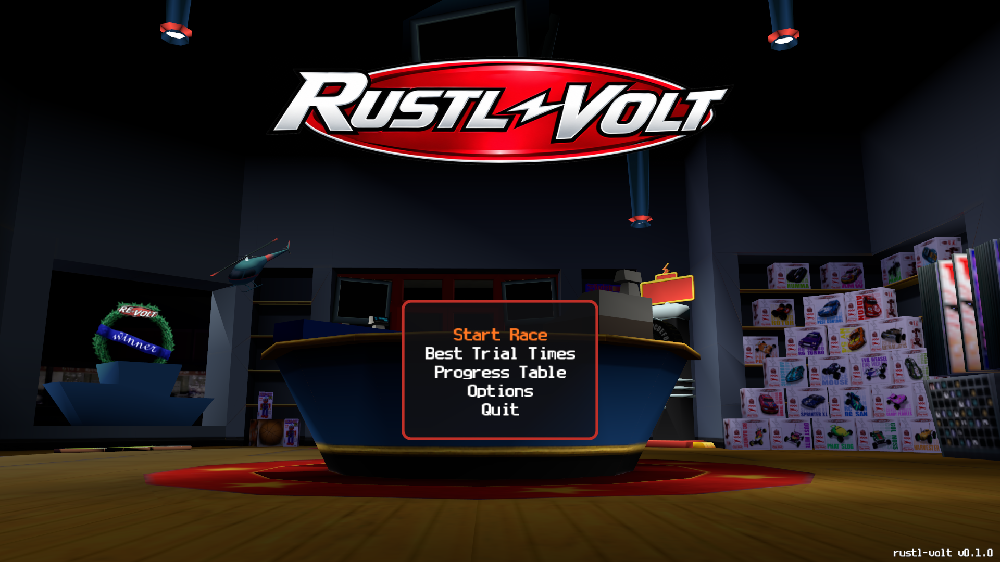
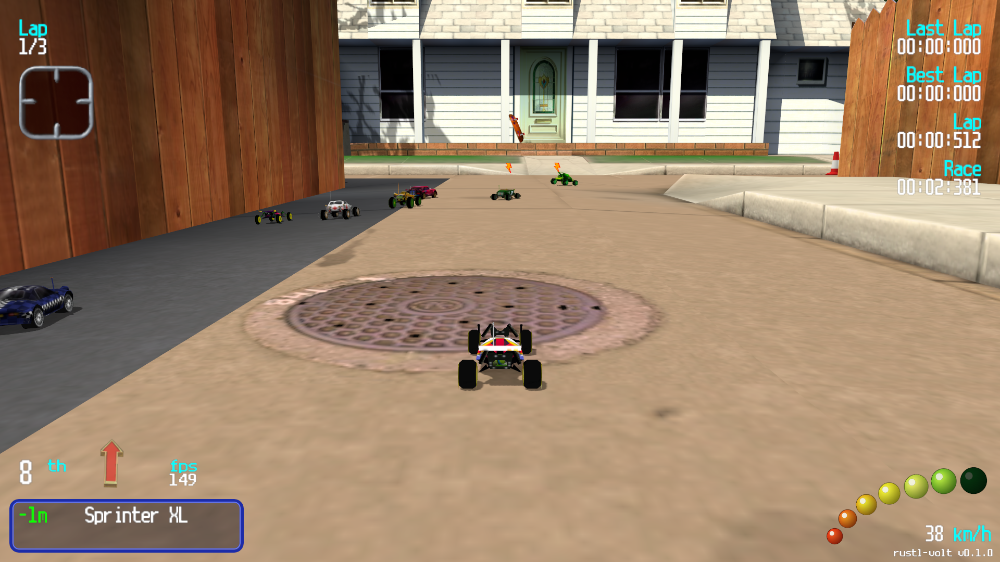
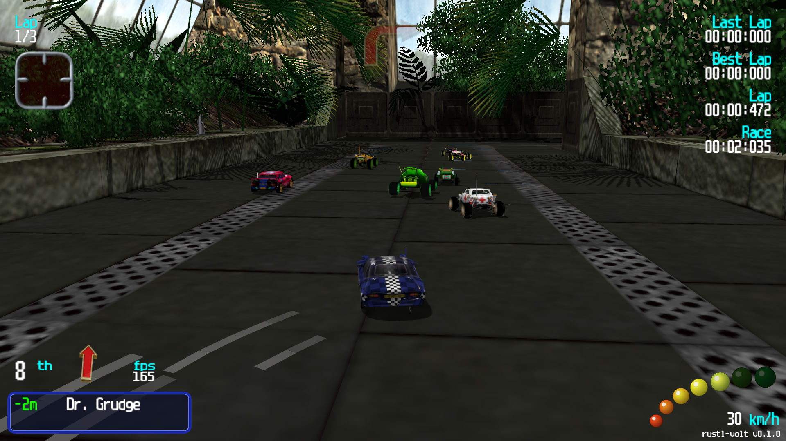
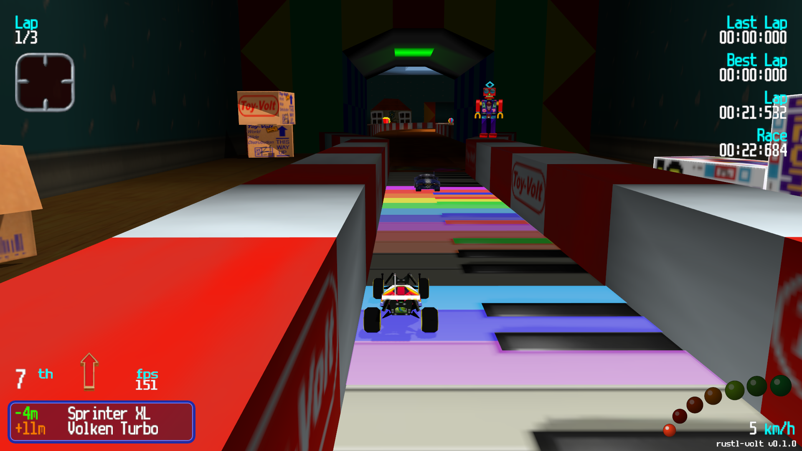

# Rustl-Volt

A remake of Re-Volt on the [rustl](https://github.com/Bastl34/rustl) engine.

No files of the original game are in this repository. Rustl-Volt converts them from your own copy the first time it starts.

## Screenshots

## What you need

- **The files of Re-Volt**, from one of two sources - the game asks at the first start:
  - **re-volt.io**: the game downloads the packs of [re-volt.io](https://re-volt.io/downloads/misc) - the game files, the car box pictures of RVGL and the Dreamcast soundtrack (about 170 MB, into the user data folder).
  - **Steam**: your installed Re-Volt ([store page](https://store.steampowered.com/app/287310/ReVolt/)). The game finds it on its own. If it does not, it asks you for the folder.
- **[rustl](https://github.com/Bastl34/rustl)** checked out, plus its toolchain (Rust and Node.js, see its README).

## Setup

1. Clone this repository into the rustl folder, as `data/projects/rustl-volt`. `code/Cargo.toml` and `converter/` find the engine at `../../../..`.
2. Start the rustl editor (`cargo dev`) and open `rustl-volt.project`.
3. Press Play in the `boot` scene. At the first start the game converts Re-Volt into `assets/` and the scenes, then it opens the menu.

## Folders

- `code/` - the game (app code of the project)
- `converter/` - the converter, as a library for the game and as a window for development (`cargo run` there)
- `ui/` - own pictures of the start screens, the font of the game (RVGL, CC BY-NC-SA 4.0)
- `formats/` - notes on the file formats of the original game

## Detailed infos about Re-Volt

Detailed info about all files and formats can be found here: [Readme.md](formats/README.md)

Also there are some schematics here: [Readme.md](schematics/README.md)

## Legal

Rustl-Volt is a non-commercial fan project. It is not affiliated with, endorsed by or connected to the owners of Re-Volt.

Re-Volt and all of its content (models, textures, tracks, sounds, music, names) belong to their respective owners. Re-Volt is a trademark of its owners.

This repository contains no files of the original game, except the font (see below). Rustl-Volt only converts game files on your own machine, from one of two sources you choose at the first start:

- **re-volt.io**: the packs of [re-volt.io](https://re-volt.io/downloads/misc), which the game downloads from there only when you choose it. The car box pictures of that download come from the asset pack of RVGL ([rvgl.org](https://rvgl.org)).
- **Steam**: the files of a copy you own ([store page](https://store.steampowered.com/app/287310/ReVolt/)).

The font of the game (`ui/font.png`, made by `ui/make_font.py` from `gfx/font.bmo` of RVGL's asset pack) is RVGL's reworked version of the original Re-Volt font, licensed by the RVGL team under [CC BY-NC-SA 4.0](https://creativecommons.org/licenses/by-nc-sa/4.0/) ([ui/LICENSE.RVGL-font.txt](ui/LICENSE.RVGL-font.txt)). Only its letters, digits and signs are used, unchanged except that they are white with the brightness as alpha.

The screenshots show the game converted from such a copy. They are only here to show the project. If you own rights to Re-Volt and want anything removed, please open an issue and it will be taken down.

The code of Rustl-Volt, the converter and the notes on the file formats are written from scratch. The original program was only studied to understand how the game behaves; none of its code is copied.